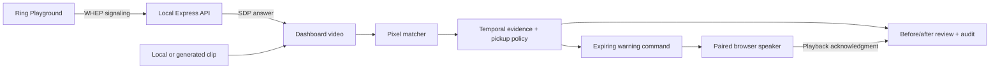

# DoorRelay Guard

A laptop-and-phone prototype for watching a parcel from delivery to confirmed collection. A resident enrolls a parcel, Guard looks for sustained movement, and a paired phone can play a short warning. Built for the Amazon App Developer Hackathon 2026, Ring track.

**Status: working local MVP, version 0.2.0.** Actual Ring device discovery, 1280×720 WHEP playback in desktop Chrome, and parcel observation are verified. The generated-video → movement → spoken warning → return flow has passed end-to-end browser testing. The user also confirmed audible speaker output. This is a foreground demo, not a field-validated security service or a published submission.

## Run

Watch the [unlisted demonstration](https://www.youtube.com/watch?v=0SHVt1pdhqw). The hackathon entry remains a draft for the owner to submit.

Requires Node.js 22 or newer and npm. On Windows, double-click `Start-DoorRelay.cmd` to install dependencies if needed, build, and run with phone pairing enabled. Desktop Chrome is the verified browser for Ring playback.

```powershell
git clone https://github.com/ahmadsmadi44/doorrelay-guard.git
cd doorrelay-guard
npm ci
$env:HOST = '0.0.0.0'
npm run dev
```

Open **http://127.0.0.1:4173/** on the laptop. `HOST=0.0.0.0` enables the companion page on the local network. Omit it for laptop-only access. The household dashboard API still requires a loopback connection and its local session cookie; a phone can only pair as a speaker. Use a trusted private network. This development server has no public deployment configuration.

For a compiled build:

```powershell
npm run build
npm start
```

`npm test` builds the app, then runs the state-machine, pixel-analysis, generated evaluation, and isolated HTTP integration tests. Stop a foreground server with Ctrl+C. Application state is stored in `.doorrelay/`, which is excluded from source control.

## Try the complete local flow

1. Leave **Synthetic test scene** selected. The initial rectangle covers the drawn parcel. Click **Enroll & observe**.
2. Click **Move parcel**. The picture changes, and the detector compares the pixels. After four matching movement observations, Guard opens a before/after review.
3. Click **Parcel in place**. Four stable observations resolve the event as returned.
4. Click **Block the view** or **Remove from view**. Guard reports uncertainty. Disappearance alone does not establish movement or queue a warning.
5. Restore the parcel, then click **Start pickup**. Movement during the two-minute authorization window does not trigger an incident. Click **Confirm collection** to finish the handoff.
6. Enroll again to start a new parcel session. Old reviews are marked superseded and stale observations cannot affect the new session.

The scene controls only change a rendered canvas. They do not call the observation or incident endpoints. This is a generated test fixture, not a physical-camera validation set.

## Give Guard a voice

1. On the laptop, select **Pair a speaker → Generate pairing code**.
2. Scan the QR code with a phone on the same Wi-Fi, or open the displayed URL.
3. Enter the six-digit code before it expires in five minutes. The code works once.
4. Tap **Enable audio** on the phone. It should say “DoorRelay speaker connected.” Readiness is enabled only after the browser reports that this audio finished.
5. Keep the phone unlocked with the page visible. Click **Test warning** on the dashboard, or trigger movement and click **Send a warning**.

The message is **“Please leave the package in the delivery area.”** It does not claim that police, a resident, or another service was notified. It plays through the companion browser, not the Ring doorbell.

Commands expire after 15 seconds, are deduplicated on the speaker, and have a 20-second warning cooldown. The dashboard distinguishes pending, started, completed, failed, and expired commands. Completed means the browser reported playback completion; it does not verify that a person heard it. The speaker must send a fresh readiness heartbeat. Hidden pages report not ready.

Automatic warnings default to off. Enable the switch explicitly for a staged demo. Review-first is the appropriate mode until the detector has been evaluated on real footage. A pickup authorization cancels audio that is still pending; audio already playing may finish.

If the phone URL does not load, check that both devices use the same private Wi-Fi, that the server was started with `HOST=0.0.0.0`, and that Windows permits Node on that private network. Guest Wi-Fi may isolate devices. No firewall rules were changed by this project.

## Connect Ring Playground

1. Sign in at [Ring Playground](https://developer.amazon.com/ring/console/playground) and generate a temporary token.
2. In DoorRelay, open **Connections**, paste it into **Temporary Playground token**, and save it.
3. Select **Discover devices**, choose the Playground device, and **Connect Ring video**. Activate a Package scenario in Playground if necessary.
4. Once actual frames arrive, select the parcel rectangle and enroll it. Ring sessions are limited; reconnect and enroll again after a session ends.

Tokens are held in server memory and disappear on restart. The UI never reads a stored token back. Do not put a token in source control or a screen recording. An optional `RING_ACCESS_TOKEN` environment variable is supported; `.env` is ignored.

Ring calls are server-to-server. The browser creates a receive-only video SDP offer after ICE gathering; the backend sends it to Ring and returns the SDP answer. Session cleanup uses Ring's returned URL, including its query string, constrained to the Ring API origin and expected endpoint path.

During the initial check, the unverified developer account could access Playground and discover its device. The portal indicated that identity verification is required before Appstore submission. That later account step remains outstanding.

See [Ring's API documentation](https://developer.amazon.com/docs/ring/api-documentation.html) for streaming and device capabilities. The official sample is [ring-api-helloworld](https://github.com/AmazonAppDev/ring-api-helloworld). The initial in-app browser could not display the live stream. Desktop Chrome successfully decoded 1280×720 video and enrolled/observed the parcel. Use Chrome for Ring; see `docs/VALIDATION.md` for evidence and the limits of testing.

## Use original staged footage

In **Connections → Your footage**, choose a local video. It stays in the browser; only low-resolution enrollment and incident JPEGs go to this laptop's server. Draw a tight box around a visible parcel, finish selection, and enroll while the clip plays. **Replay video** clears the prior observation session so you can enroll again.

Film a fixed camera view with a textured parcel or visible shipping-label pattern. Include a few seconds of the parcel at rest before moving it. The matcher searches three scales (85%, 100%, 115%) and three angles (−15°, 0°, +15°), refines candidate positions, and rejects similarly strong matches in separate areas; rotation, changing distance, similar-looking objects, shadows, and occlusion can defeat it. Similarity scores are not calibrated probabilities. It cannot reliably identify a parcel that has left the frame.

No face recognition or identity inference is used. A pickup window represents the resident's authorization, not proof of who appears in the video.

## Implementation

- React + TypeScript dashboard and phone companion, Vite, bundled local fonts.
- Express same-origin API; local admin session and revocable speaker token.
- Pixel-based reference matching in the dashboard at approximately 2.5 samples per second. Four consistent observations are required; gaps and uncertainty reset the streak.
- Explicit parcel, incident, pickup, and output-command states.
- Atomic local JSON persistence in `.doorrelay/state.json`. A restart always disarms observation and expires pending sound.
- Before/after evidence and a bounded household timeline. Incident images expire after 24 hours while the server runs; the active parcel reference remains until replacement. No full video recording is stored.

Dashboard observation requires the page to remain open and visible. Frozen or ended video does not generate fresh observations. This is not an unattended security service.

The optional signed-webhook endpoint only validates and acknowledges the payload, returning `processing: not-enabled-in-local-prototype`. It does not start a background worker. No web push, multi-user household accounts, AWS deployment, automatic package detector, or cloud event pipeline is implemented yet.

## Product limits and future work

1. Ring playback and stable parcel observation pass in desktop Chrome. Reliable detection of actual Ring parcel removal still requires a recorded evaluation; we do not claim that the real clip triggered a validated theft/removal event.
2. Audible warning output, browser mute, command acknowledgments, token revocation, and server restart are tested. OS-level phone lock and Wi-Fi interruption remain device-specific field tests.
3. Record at least 20 original staged clips and reserve a held-out set. Measure missed movement, false reviews, false warnings, and latency. Synthetic tests do not substitute for this evaluation.
4. Extend beyond modest scale/rotation and fixed viewpoints. Automatic warnings remain off by default; enable them deliberately for controlled tests.
5. Complete submission documentation, developer friction report, demo video, and any account verification required by the chosen submission path.

## Media attribution

Ring Playground's Package clip is “Thief stealing our package” by [frollard](https://www.youtube.com/watch?v=TfTFu8lGrwk), supplied by Playground under [CC BY 4.0](https://creativecommons.org/licenses/by/4.0/). The app includes attribution beside that source; evidence previews are resized. The generated synthetic doorway is original project code and visibly labeled. Fonts and dependencies retain their own licenses.

## Included deliverables

- `public/samples/generated-parcel-test.mp4`: original labeled-in-UI regression video; no Ring clip is redistributed. Rebuild with `npm run fixtures` if FFmpeg is installed.
- `docs/VALIDATION.md`: automated and browser test evidence.
- `docs/SUBMISSION-DRAFT.md`: factual Devpost copy.
- `docs/DEMO-SCRIPT.md`: timed demo and recording runbook.
- `LICENSE`: MIT license for project code; dependencies and Ring media have separate licenses.
- Activity view: authenticated JSON report export and local evidence-image clearing.



## Save a review clip

Click **Record review clip**, exercise the flow, then **Stop recording** and **Download review clip**. The local export contains the displayed video and live application status, up to 60 seconds at 1280×720. It is silent: it does not capture a microphone or the companion speaker. Recording stops when the page becomes hidden. Sources retain their visible labels and Ring footage retains attribution. The file stays in browser memory until downloaded or replaced; closing the page discards it.

The warning and connection-test audio are bundled MP3 files. No runtime text-to-speech service is required. Browser `playing`/time-progress and `ended` events drive acknowledgments. A canceled command cannot be reported as completed, and a five-second start timeout turns audio readiness off.
